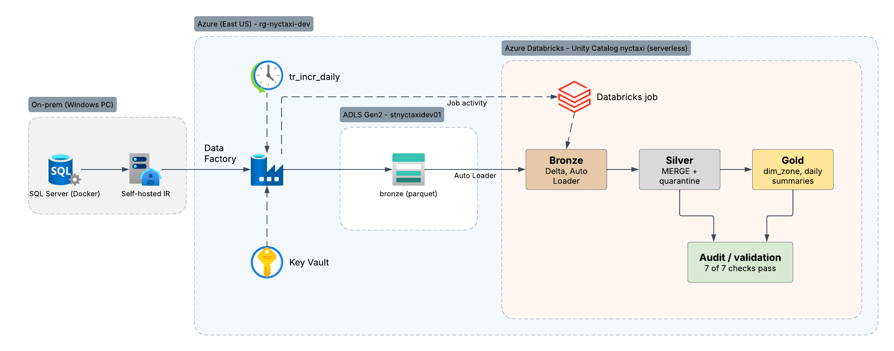

# NYC Taxi Data Migration (on-prem SQL Server → Azure)

An end-to-end simulation of a real on-prem → cloud data migration: ~121M NYC TLC taxi trips move from a SQL Server "on-prem" database to an Azure lakehouse with full + incremental loads, a medallion model in Databricks, automated orchestration, and row/checksum validation at every layer.



## Stack
| Layer | Tech |
|---|---|
| Source ("on-prem") | SQL Server 2022 in Docker on a Windows PC |
| Ingestion | Azure Data Factory + self-hosted integration runtime |
| Secrets | Azure Key Vault (ADF linked service passwords) |
| Landing | ADLS Gen2 (`bronze` container, parquet) |
| Processing | Azure Databricks (serverless), Unity Catalog, Delta Lake, Auto Loader |
| Orchestration | ADF schedule trigger → ADF pipeline → Databricks job |

## Data
- NYC TLC yellow + green trip records, Jan 2024 – Aug 2026 (Sept 2026 held out for incremental tests)
- Source control totals: **yellow 119,595,677 rows, green 1,588,707 rows**
- Lookups: vendor, rate code, payment type, trip type, taxi zone (265)

## Pipeline
1. **Source DB**: `trips.yellow_trip` / `trips.green_trip` (identity `trip_id`, `created_at` watermark column, indexed), lookups in `ref.*`. Source stays raw; all cleaning happens in silver.
2. **Full load** (`pl_full_load_trips` → `pl_load_trip_month`): month-by-month copy to `bronze/nyctaxi/<table>/year=YYYY/month=MM/`, every month logged in `etl.adf_load_log`. Restartable: only months without a success row are reloaded.
3. **Incremental load** (`pl_incr_load_trips`): `created_at` watermark in `etl.watermark` → new rows land in `bronze/nyctaxi/<table>/incremental/load_id=<runId>/`, then ADF starts the Databricks job.
4. **Bronze**: Auto Loader (`availableNow`) → `nyctaxi.bronze.<table>` with `_source_file`, `_ingested_at`. Checkpoints make reruns load nothing twice.
5. **Silver**: streams new bronze rows → dedupe → quarantine impossible rows (`trip_quarantine` with reason) → NULL-out fake values → flags (`pricing_type`, `is_adjustment`, `is_reversal`) → `MERGE` into `nyctaxi.silver.<table>`.
6. **Gold**: `dim_zone`, `v_trip` (yellow + green union), `daily_trip_summary`, `daily_zone_pickups`.
7. **Orchestration**: trigger `tr_incr_daily` (daily, pipeline concurrency 1) → `pl_incr_load_trips` → Job activity → Databricks job `job_nyctaxi_medallion` (bronze → silver → gold, serverless, `tables` parameter so tests can run green only).

## Data quality rules (silver)
| Issue (from profiling) | Rule |
|---|---|
| Pickup before 2024 / in the future, dropoff ≤ pickup, trip > 24h, fare > $1000 | Quarantine with reason |
| Distance ≤ 0 or > 100 mi, speed > 100 mph, passenger_count 0, rate_code 99 | Keep row, set value to NULL |
| `payment_type` 0 = Flex Fare (~25% of yellow) | `pricing_type = 'FLEX'`; trust `total_amount` only |
| Negative totals | `is_adjustment = true` |
| Charge + reversal pairs (~866K yellow) | `is_reversal = true` (flagged, not deleted) |
| Duplicate bronze copies | Keep latest `_ingested_at` per `trip_id` |

## Validation
`databricks/validation/01_validation.sql` compares each layer with the source answer key (`audit.control_totals`, copied to the lake by ADF) and writes results to `nyctaxi.audit.validation_results`:
- row counts and `total_amount` checksums: source → bronze → silver + quarantine → gold
- ADF run log: latest attempt for every month succeeded, ADF rows copied = bronze rows

**Result: green 7/7 PASS, yellow 7/7 PASS.**
Incremental test: 10,000 simulated green rows → 9,994 silver + 6 quarantine (no rows lost).

## Findings and lessons learned
- **Cutover gap (89,998 rows, Sept 2026).** Rows inserted between the full load and the first incremental run were missed because the watermark was set after the full load. Fix: initialise the watermark *before* the full load starts; backfilled with `pl_load_trip_month`.
- **Bronze double-ingest.** Changing the Auto Loader checkpoint path made it re-read every file. Fix: deleted the older copy; checkpoint folders are never renamed.
- **CHAR(7) padding.** `year_month = 'INCR'` arrived as `'INCR   '` and broke joins. Fix: `trim()` in validation.
- **Stale "running" log rows.** Failed/retried months left old rows. Fix: validate the latest attempt per month only.
- **Control totals timing.** Rows inserted after the snapshot caused a +2 mismatch. Fix: take a new snapshot right before each load.
- **Cost.** One full yellow reload on Databricks cost ~$25. Fix: serverless only, auto-stop ≤ 10 min, build and test on green, run yellow once.

## Repo layout
```
source_db/      docker-compose, schema, lookups, control totals, security (adf_reader),
                ADF log/watermark tables, reconcile queries, profiling/01-08
scripts/        download_trips.ps1, load_parquet.py, simulate_inserts.py, source_counts.py
adf/            ADF ARM template export (pipelines, datasets, linked services, trigger)
databricks/
  bronze/       Auto Loader load + reconcile
  silver/       tables, incremental load (transform / MERGE / quarantine / reversals), reconcile
  gold/         gold tables + reconcile
  validation/   end-to-end validation checks
  jobs/         job_nyctaxi_medallion definition (JSON)
docs/           architecture diagram
```

## How to run
1. `cp source_db/.env.example source_db/.env`, set passwords; `docker compose -f source_db/docker-compose.yml up -d`
2. Create DB `NYCTaxi`; run `schema.sql`, `seed_lookups.sql`, `security.sql`, `adf_load_log.sql`, `watermark.sql`
3. `scripts/download_trips.ps1` → `python scripts/load_parquet.py` → run `control_totals.sql`
4. Deploy `adf/ARMTemplateForFactory.json` to a data factory, install the self-hosted IR, set Key Vault secrets
5. Run `pl_load_ref` and `pl_full_load_trips`, then the Databricks job (or notebooks bronze → silver → gold)
6. Run `databricks/validation/01_validation.sql` for each taxi type; every check must PASS
7. Ongoing: `python scripts/simulate_inserts.py --table green --rows 1000` → `tr_incr_daily` (or Trigger now)

> The self-hosted IR runs on the PC, so pipelines only work while the PC and Docker are on.
